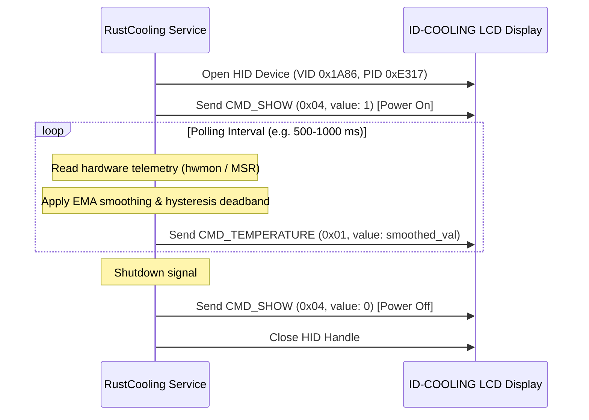

# ID-COOLING LCD Display Protocol & Architecture Memo (RustCooling)

Technical architectural memo and guide for developing, maintaining, and extending **RustCooling** — an ultra-lightweight, zero-bloat, cross-platform LCD display controller for **ID-COOLING FX Series** liquid coolers (FX240, FX280, FX360) and compatible WCH-based AIO hardware.

---

## 1. Hardware Identification (USB HID)

- **Vendor ID (VID):** `0x1A86` (QinHeng Electronics / WCH)
- **Product ID (PID):** `0xE317`
- **Device Class:** USB HID (Human Interface Device)
- **Report Length:** 64 bytes (on Windows, Win32 HID API / `WriteFile` prepends Report ID `0x00` -> 65 bytes total).
- **I/O Mode:** Synchronous I/O (Non-overlapped).

---

## 2. Hardware Protocol Specification

### Display Characteristics
The ID-COOLING FX pump cap houses a microcontroller driving a **2-digit 7-segment LED display** with a fixed static Celsius (°C) indicator.
- The hardware controller **only physically renders command `0x01`** (numeric value) on the 7-segment display.
- Opcodes `0x02` (Frequency) and `0x03` (CPU Load) were legacy vendor placeholders and do not render distinct metrics on the physical panel. RustCooling routes all telemetry modes (temperature, CPU load, and synthetic metrics) through `CMD_TEMPERATURE` (`0x01`).

### Frame Format (64 Bytes)

Each HID output report consists of 64 bytes:

| Byte(s) | Field Name | Value / Description |
| :--- | :--- | :--- |
| `0` | Header 1 | `0x55` |
| `1` | Header 2 | `0xBB` |
| `2` | Data Length | `0x02` (payload value length in bytes) |
| `3` | Command (`cmd`) | Command opcode (see table below) |
| `4` | Value High (`valHi`) | `(value >> 8) & 0xFF` (Big-Endian high byte) |
| `5` | Value Low (`valLo`) | `value & 0xFF` (Big-Endian low byte) |
| `6` | Checksum (`cksum`) | `(byte[0] + byte[1] + byte[2] + byte[3] + byte[4] + byte[5]) & 0xFF` |
| `7..63` | Padding | 57 zero bytes (`0x00`) |

### Command Table

| Command | Hex | Description | Value Format (`u16`) |
| :--- | :---: | :--- | :--- |
| `CMD_TEMPERATURE` | `0x01` | Renders number on the 7-segment display | Numeric value `0`–`99` (clamped up to `199`) |
| `CMD_SHOW` | `0x04` | Powers display panel on or off | `1` = Screen On (`0x0001`), `0` = Screen Off (`0x0000`) |

### Checksum Calculation

```rust
pub fn calculate_checksum(header1: u8, header2: u8, len: u8, cmd: u8, val_hi: u8, val_lo: u8) -> u8 {
    (header1 as u16 + header2 as u16 + len as u16 + cmd as u16 + val_hi as u16 + val_lo as u16) as u8
}
```

---

## 3. Communication Lifecycle



---

## 4. Telemetry Architecture

### Linux (sysfs & hwmon):
- **Temperature:** Discovered via `/sys/class/hwmon/hwmon*/temp*_input` matching known drivers (`k10temp`, `zenpower`, `coretemp`, `Tctl`, `Tdie`, `Package id 0`).
- **Caching:** Sensor paths are cached in `LinuxTelemetry` (`cached_paths`) upon initialization. Avoid re-enumerating `/sys/class/hwmon` directory entries on every tick.
- **CPU Load:** Computed from delta counters in `/proc/stat`.
- **Permissions:** Unprivileged access enabled via `99-idcooling.rules` (`MODE="0666", TAG+="uaccess"`).

### Windows (MSR via Kernel Driver):
- **Driver:** Embedded ring-0 driver (`assets/driver/WinRing0x64.sys`) loaded dynamically via Windows Service Control Manager (`WinRing0_1_2_0`). Unloaded on process exit.
- **MSR Queries:** Direct TjMax (`0x1A2`) and core thermal status (`0x19C`, `0x1B1`) reads.
- **Fallback:** Graceful ACPI thermal zone readout via `sysinfo`.

---

## 5. UI Architecture & Memory Optimization Rules

### Zero-Bloat Memory Design:
1. **Deferred Window Surface Initialization:**
   - When launched with `--minimized`, **never** invoke `w.show()` or initialize an OpenGL surface before the user explicitly requests the window.
   - Initializing FemtoVG/EGL loads GPU drivers (Mesa / NVIDIA shader compiler libraries) into resident memory (~50–80 MB RSS). Starting straight into the tray keeps the process at **~20–25 MB RSS**.
2. **No GTK Runtime Dependency:**
   - System tray integration is built on `tray-icon` and `muda` with `default-features = false`.
   - Avoid `gtk::init()` or GTK event pump loops in the timer, which bring in Pango, ATK, and GtkStyleContext overhead.
3. **UI Event Timer Frequency:**
   - Periodic UI tick timer is set to **250 ms** (not 60 ms) to keep idle CPU usage at 0.0%.
4. **Dimensions & Localization:**
   - Window dimensions: **360 x 352 px**.
   - Supported languages: `en`, `ru`, `zh`, `de`, `fr` (managed by `I18n` singleton).

---

## 6. Packaging & Deployment Matrix

- **AppImage:** Standard portable Linux packages (`RustCooling-GUI`, `RustCooling-TUI`) produced via `appimagetool`.
- **Debian (`.deb`):** Built with `packaging/deb/build_deb.sh` using `dpkg-deb`.
- **RPM (`.rpm`):** Built with `packaging/rpm/build_rpm.sh` using `rpmbuild`.
- **Arch Linux:** Built using `packaging/arch/PKGBUILD` and AUR package.
- **Windows:** Standalone executable `RustCooling-1.0.0.exe`.
