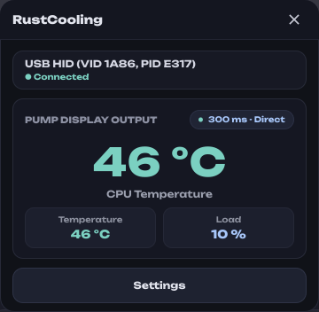
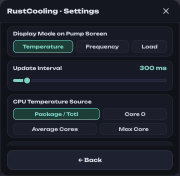
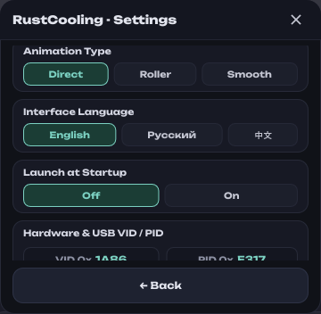
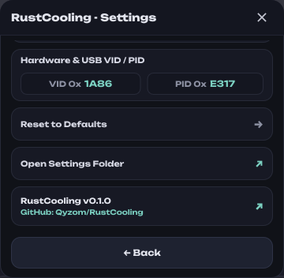

<div align="center">


# RustCooling

**Ultra-lightweight LCD display driver & controller for ID-COOLING FX & FROZN Temp Display coolers.**  
*Native Linux & Windows • Modern GUI • Interactive TUI • Silent Daemon • USB `1a86:e317`*

[](LICENSE)
[](https://www.rust-lang.org/)
[](https://slint.dev/)
[](https://ratatui.rs/)
[](https://github.com/Qyzom/RustCooling/releases/latest)

<br/>



<br/><br/>





</div>

---

### Overview

**RustCooling** is a fast, lightweight, and native alternative to the bloated vendor utility for **ID-COOLING FX Series** (FX240, FX280, FX360) and **FROZN / Temp Display** liquid coolers (USB `1a86:e317`, product string `IDCOOL-C`), as well as OEM rebrands (such as Aftershock PC prebuilts).

It communicates directly with the pump cap's USB HID microcontroller to stream CPU temperature and usage without running background Chromium, Electron, or heavy runtimes. Compatible alongside `liquidctl` and `CoolerControl` setups.

---

### Key Highlights

- **Two Dedicated Editions:**
  - **GUI Edition (`RustCooling`):** Compact Slint interface with system tray minimization and udev wizard.
  - **CLI / TUI Edition (`rustcooling-cli`):** Standalone terminal dashboard with live graphs and a silent headless daemon.
- **Measured Resource Usage (Real Hardware):**
  - **Headless Daemon (`rustcooling-cli --daemon`):** **4.2 MB RSS** (measured on live hardware during continuous USB HID streaming).
  - **Interactive TUI Dashboard (`rustcooling-cli --tui`):** **~5 MB RSS**.
  - **GUI on Windows:** **~12–14 MB RSS**.
  - **GUI on Linux (Mesa / Tray):** **~20–25 MB RSS**.
- **Smooth Display:** Configurable exponential moving average (EMA) and deadband hysteresis filter to eliminate 7-segment digit flicker.
- **Native Linux Telemetry:** Scans `/sys/class/hwmon` and `/proc/stat` with cached sensor paths (no Wine or kernel drivers required).
- **Direct Windows Telemetry:** High-precision MSR readings via an embedded ring-0 telemetry driver (with safe ACPI fallback).
- **Status Bar Integration:** Quick one-shot query (`rustcooling-cli --status`) for Waybar, Polybar, or shell scripts.
- **Multi-Language:** English, Russian, Simplified Chinese, German, and French.

---

### Comparison

| Feature | Official Vendor Utility | RustCooling (CLI / Daemon) | RustCooling (GUI) |
| :--- | :---: | :---: | :---: |
| **Tech Stack** | Electron / Node.js + C++ | **Pure Rust (Ratatui / Daemon)** | **Pure Rust (Slint)** |
| **Headless Daemon RAM** | ❌ None | **4.2 MB RSS** *(live measured)* | — |
| **TUI Dashboard RAM** | ❌ None | **~5 MB RSS** | — |
| **GUI in Tray (Windows)** | ~200 – 350 MB | — | **~12 – 14 MB RSS** |
| **GUI in Tray (Linux)** | ❌ None | — | **~20 – 25 MB RSS** *(Mesa)* |
| **Hysteresis / Smoothing** | ❌ None (jittery) | **✔ Configurable (0–5°C)** | **✔ Configurable (0–5°C)** |
| **Linux Support** | ❌ None | **✔ Native (`hwmon`, `sysfs`)** | **✔ Native (`hwmon`, `sysfs`)** |
| **Startup Overhead** | 3 – 5 sec | **< 15 ms** | **< 30 ms** |
| **Idle CPU Usage** | ~1 – 3% | **0.0%** | **0.0%** |

> [!TIP]
> **Linux Tip:** If you want zero background overhead for 24/7 cooling display operation without loading OpenGL/GPU driver libraries into memory, run **`rustcooling-cli --daemon`** (or enable the user systemd service). It consumes only **4.2 MB RAM**.

---

### Usage

RustCooling provides two dedicated binaries tailored for different environments:

#### 1. GUI Edition (`RustCooling`)

```bash
# Launch graphical interface:
RustCooling

# Launch directly minimized to system tray:
RustCooling --minimized
```

#### 2. CLI & TUI Edition (`rustcooling-cli`)

```bash
# Launch interactive terminal UI (TUI dashboard):
rustcooling-cli            # or: rustcooling-cli --tui / -t

# Run as background headless daemon (~4 MB RAM):
rustcooling-cli --daemon   # or: rustcooling-cli -d

# One-shot status query (for Waybar, Polybar, or shell scripts):
rustcooling-cli --status   # or: rustcooling-cli -s

# Stop running daemon and power off pump display:
rustcooling-cli --stop
```

---

### Installation & Downloads

Pre-built binaries for each release are available on the [**Releases**](https://github.com/Qyzom/RustCooling/releases/latest) page:

| Platform | GUI Edition | TUI / CLI Edition |
| :--- | :--- | :--- |
| **Linux (AppImage)** | `RustCooling-GUI-1.0.0.AppImage` | `RustCooling-TUI-1.0.0.AppImage` |
| **Ubuntu / Debian** | `RustCooling-GUI-1.0.0.deb` | `RustCooling-TUI-1.0.0.deb` |
| **Fedora / RHEL** | `RustCooling-GUI-1.0.0.rpm` | `RustCooling-TUI-1.0.0.rpm` |
| **Arch Linux** | `PKGBUILD` in `packaging/arch` | `PKGBUILD` in `packaging/arch` |
| **Windows 10 / 11** | `RustCooling-1.0.0.exe` | — |

#### Linux USB Permissions (udev)

To access the USB display without root permissions, install the udev rule:

```bash
echo 'SUBSYSTEM=="hidraw", ATTRS{idVendor}=="1a86", ATTRS{idProduct}=="e317", MODE="0666", TAG+="uaccess"' | sudo tee /etc/udev/rules.d/99-idcooling.rules
sudo udevadm control --reload-rules && sudo udevadm trigger
```

*(Pre-packaged `.deb`, `.rpm`, and Arch packages install and activate this rule automatically).*

---

### Building from Source

Requires a Rust 1.75+ toolchain:

```bash
git clone https://github.com/Qyzom/RustCooling.git
cd RustCooling
cargo build --release
```

Output binaries in `target/release/`:
- GUI Edition: `RustCooling` (Windows: `RustCooling.exe`)
- CLI / TUI Edition: `rustcooling-cli`

---

### License

Distributed under the [MIT License](LICENSE).  
Embedded font and driver licenses are documented in [`assets/`](assets/).
