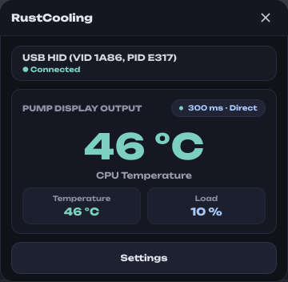
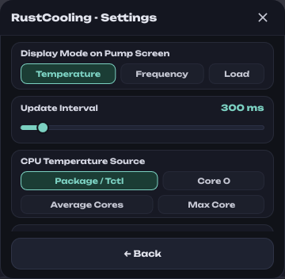
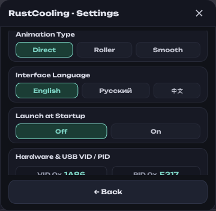
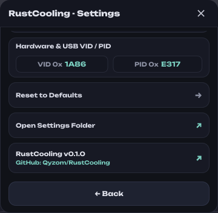

<div align="center">


# RustCooling

**Ultra-lightweight LCD display controller for ID-COOLING FX Series liquid coolers.**  
*100% Pure Rust • Native Linux & Windows • Zero Bloat • GUI (~12 MB) • TUI (~5 MB) • Daemon (~2 MB)*

[](LICENSE)
[](https://www.rust-lang.org/)
[](https://slint.dev/)
[](https://ratatui.rs/)
[]()
[](https://github.com/Qyzom/RustCooling/releases)

<br/>



<br/><br/>





</div>

---

### Overview

**RustCooling** is an open-source, ultra-efficient alternative to the bloated official vendor utility for **ID-COOLING FX Series** AIO liquid coolers (FX240, FX280, FX360). 

The hardware controller is simple: it only renders numeric values (`CMD_TEMPERATURE`, `0x01`) and toggles screen power (`CMD_SHOW`, `0x04`). RustCooling provides a direct, minimal, and rock-solid wrapper around this protocol with hardware-accelerated GUI, terminal TUI, and silent background daemon support.

---

### Highlights

1. **Lightweight & Fast:** Written in 100% pure Rust. GUI consumes ~12 MB RAM (<3 MB in tray), interactive TUI takes ~5 MB, and headless daemon runs at ~2 MB with 0.0% background CPU.
2. **Smooth Display Readings:** Built-in exponential moving average (EMA) and deadband hysteresis filter (0–5°C) to eliminate distracting 7-segment number jitter.
3. **True Native Linux Support:** Reads CPU telemetry driverless via kernel sysfs (`/sys/class/hwmon` and `/proc/stat`) without requiring root rights or Wine.
4. **Direct Windows Silicon Telemetry:** High-precision Intel DTS and AMD Ryzen telemetry via IA32 MSRs using an embedded LibreHardwareMonitor micro-driver with automatic kernel memory unloading.
5. **Interactive Terminal UI (TUI):** Minimalist Ratatui dashboard with telemetry gauges, sparklines, and full settings editor. Detaches seamlessly to a background daemon on terminal closure.
6. **One-Shot Status Query:** Run `rustcooling status` for instant telemetry output formatted for Waybar, Polybar, or scripts.
7. **Multi-Language Support:** Full runtime localization in English (`en`), Russian (`ru`), Chinese (`zh`), German (`de`), and French (`fr`).

---

### Quick Comparison

| Feature | Official Vendor Utility | RustCooling |
| :--- | :---: | :---: |
| **Tech Stack** | Electron / Node.js + C++ | **100% Pure Rust + Slint & Ratatui** |
| **Active GUI RAM** | ~200 – 300 MB | **~12 – 14 MB** |
| **System Tray RAM** | ~200 MB | **< 3 MB** |
| **Interactive TUI** | ❌ None | **✔ Yes (~5 MB RAM)** |
| **Headless Daemon** | ❌ None | **✔ Yes (~2 MB RAM)** |
| **Background CPU** | 2.0% – 5.0% | **0.0%** (Event-driven) |
| **Hysteresis Smoothing**| ❌ Jitters constantly | **✔ Yes (Configurable 0–5°C deadband)** |
| **Linux Support** | ❌ None | **✔ Native (`hwmon`, `sysfs`, `udev`)** |
| **Startup Time** | 3.0 – 6.0 sec | **< 50 ms** |

---

### CLI & TUI Usage

```bash
# Launch GUI (or interactive TUI if in terminal-only build):
rustcooling

# Launch interactive Terminal UI (Ratatui dashboard):
rustcooling tui         # or: rustcooling -t

# Launch headless background daemon:
rustcooling daemon      # or: rustcooling -d

# Non-blocking telemetry query (for Waybar / status bars):
rustcooling status      # or: rustcooling -s

# Power off pump screen and stop background daemon:
rustcooling stop
```

---

### Downloads & Quick Start

Pre-built standalone releases are available on the [**Releases**](https://github.com/Qyzom/RustCooling/releases/latest) page:

| OS | Package Asset | Architecture | Description |
| :--- | :--- | :---: | :--- |
| **Windows 10 / 11** | [**`RustCooling-1.1.0.exe`**](https://github.com/Qyzom/RustCooling/releases/latest) | x86_64 | Standalone portable executable with embedded kernel driver |
| **Universal Linux** | [**`RustCooling-GUI-1.1.0.AppImage`**](https://github.com/Qyzom/RustCooling/releases/latest) | x86_64 | Standalone GUI AppImage (Slint + OpenGL + System Tray) |
| **Universal Linux** | [**`RustCooling-TUI-1.1.0.AppImage`**](https://github.com/Qyzom/RustCooling/releases/latest) | x86_64 | Standalone terminal TUI & CLI AppImage |

#### Linux Quick Run

```bash
# GUI AppImage
chmod +x RustCooling-GUI-1.1.0.AppImage
./RustCooling-GUI-1.1.0.AppImage

# TUI / CLI AppImage
chmod +x RustCooling-TUI-1.1.0.AppImage
./RustCooling-TUI-1.1.0.AppImage
```

#### Linux USB Permissions (udev Rule)
On Linux, accessing the USB LCD display without root (`sudo`) requires a `udev` rule for non-root user permissions.  
The GUI has a built-in setup wizard with one-click permission installation via `pkexec`. Alternatively, you can configure it manually in one command:

```bash
echo 'SUBSYSTEM=="hidraw", ATTRS{idVendor}=="1a86", ATTRS{idProduct}=="e317", MODE="0666", TAG+="uaccess"' | sudo tee /etc/udev/rules.d/99-idcooling.rules && sudo udevadm control --reload-rules && sudo udevadm trigger
```

#### Linux Systemd User Service (Optional Daemon)
To run RustCooling silently in the background on user login:
```bash
systemctl --user enable --now rustcooling
```

---

### Hardware Protocol (USB HID)

- **Vendor ID (VID):** `0x1A86` (QinHeng Electronics / WCH)
- **Product ID (PID):** `0xE317`
- **Report Length:** 64 bytes (on Windows, Win32 prepends Report ID `0x00` -> 65 bytes total).

```
[0x55, 0xBB, 0x02, CMD, VAL_HI, VAL_LO, CKSUM, 0x00 x 57]
```

- `CMD_TEMPERATURE` (`0x01`): Number rendered on 7-segment display (numeric range: `0`–`99`, clamped up to `199`).
- `CMD_SHOW` (`0x04`): Display panel power control (`0x0001` = on, `0x0000` = off).
- `CKSUM`: Sum of the first 6 bytes modulo 256.

---

### Building from Source

```bash
git clone https://github.com/Qyzom/RustCooling.git
cd RustCooling
cargo test
cargo build --release
```

Compiled binaries:
- Windows: `target/release/RustCooling.exe`
- Linux GUI: `target/release/RustCooling`
- Linux CLI/TUI: `target/release/rustcooling-cli`

---

### License

Licensed under the [MIT License](LICENSE).  
Third-party font and driver licenses are documented in [`assets/`](assets/).
